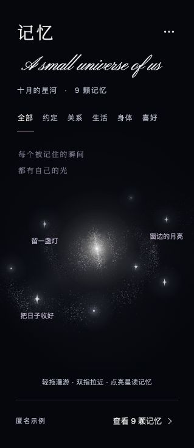

# 记忆星河网页预览

独立静态网页，用于确认星图画面、字体和交互。所有记忆均为匿名虚构示例，不调用服务器。

## 运行

在本目录执行：

```sh
python3 -m http.server 8943 --bind 127.0.0.1 --directory dist
```

打开 http://127.0.0.1:8943/ 。这个地址只在启动服务的电脑上有效；GitHub 文件页面不等于已部署的网站。

```sh
node test.mjs
node --check dist/app.mjs
node --check dist/model.mjs
```

## 入口

- `dist/index.html`：主预览。
- `dist/app.mjs`：WebGL 星尘、画面光效、流星、手势和示例卡片。
- `dist/model.mjs`：匿名示例、三维投影、固定种子星尘、呼吸与流星路径。
- `dist/style.css`：布局与选定标题字体。
- `dist/fonts-slanted.html`：含选定的 15 号字体；早期对照从 `dist/fonts.html` 进入。
- [交接与验证范围](../../docs/HANDOFF-MEMORY-GALAXY-WEB.md)。

## 操作

拖动漫游，上下拖动时视角倾角轻微变化；双指或滚轮缩放。上方分类筛选示例星，点亮星打开卡片，可前后翻看。菜单提供暂停、流星、缩放和复位；键盘可操作记忆按钮，Escape 收起面板。系统减弱动态时停止装饰循环。

## 数据边界

真实数据由 Claude 接入，本网页不承担导入、认证、服务器同步或纠错业务。`model.mjs` 的 `memories` 与 `app.mjs` 的 `buildMemoryUI` / `openMemory` 是展示适配入口；`project` 与 WebGL 顶点着色器的投影必须保持一致。喜欢仅保留在本次页面会话。

## 素材

星图由程序绘制，不依赖背景图片。选定的英文标题为 Pinyon Script Regular，额外右倾 16°、横向比例 0.9；字体本身未修改。各字体的 OFL 许可随 `dist/assets/` 保存。中文 Noto Serif SC 尚为完整文件，移动端正式交付前需要字体子集化及性能测试。

## 实际网页截图



截图来自本机浏览器，不是 iPhone 真机截图。更多验证限制见交接。
