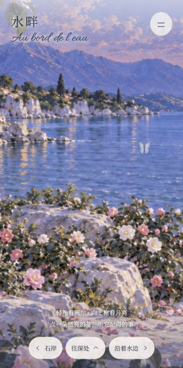
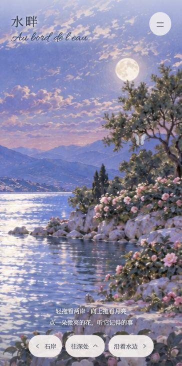
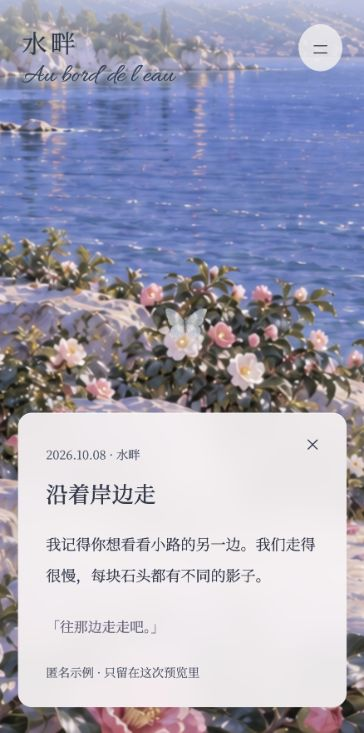

# 水畔 · 2.5D 记忆花园预览

先验收一个地点的画风和探索手感。花海直接画在岸边、石缝和枝叶里，记忆只是画中花心的微光，不再叠独立花朵图片。

这是网页候选，尚未得到佳佳确认。不是 Build 94 安装包，没有修改 App，也没有接入真实记忆。

## 先看效果







[20 秒实时漫游录像](review/walkthrough-20s.webm)

录像为浏览器 Canvas 实时录制，镜头路线由网页演示按钮驱动，不是静态图拼接，也不是真机手指操作录像。录像将网页标题、记忆卡片文字同步绘制到录制画布；实际 DOM 控件样式以截图和网页为准。没有录制桌面、麦克风或其他窗口。

## 在本机打开

需要 Node.js，无第三方依赖。在仓库根目录运行：

```sh
node Design/WaterGardenPreview/serve.mjs
```

打开 `http://127.0.0.1:8941/`。普通 GitHub 文件页面不能直接运行这个网站；本轮没有部署到公网，也没有启用 GitHub Pages。

也可以用任何静态服务器托管 `dist/`，只是自动保存录像的 `/capture` 接口需要上述本地服务；不支持保存时网页会提供下载链接。

## 怎么走

- 左右拖动：看两岸。向上拖动：抬头。双指或滚轮：拉近、拉远。
- 点微亮花心：镜头靠近，蝴蝶落下，匿名记忆浮现；合上后回到原来视角。
- 菜单里的「寻找记忆花」：用文字列表定位，键盘也能操作。
- 「石岸 / 往深处 / 沿着水边」：推进到探索入口，显示下一处尚未开放，可返回。没有伪装成已完成多个地点。
- 菜单「减弱动态」：停止装饰动效，镜头直接定位。默认跟随系统设置。
- 「录一段 20 秒漫游」：录制实际画布。触碰画面、按 Escape 或切换到后台会中断录制。

## 给 Claude 的代码入口

| 文件 | 职责 |
| --- | --- |
| `dist/world.mjs` | 原画坐标、24 个花心锚点、镜头变换、命中测试、ID 分配与溢出 |
| `dist/fixtures.mjs` | 24 条匿名示例。后续以适配器替换，不要把真实记忆提交仓库 |
| `dist/app.mjs` | 三层渲染、拖动缩放、蝴蝶、记忆卡片、录制 |
| `dist/assets/midground.png` | 花、枝叶、岸石、水面共同绘制的中景，透明天空 |
| `dist/assets/far.png` | 天空、月亮、远山和远水 |
| `dist/assets/foreground.png` | 透明近景叶枝 |
| `dist/assets/master.png` | 母画，便于校准和后续出图，不参与运行时叠图 |
| `ASSET-PROMPTS.md` | 素材生成提示词及继承来源 |

每个热点使用中景同一套变换，点击命中不会脱离花心。`allocateMemories(records, previousManifest)` 返回 ID→slot ID；把返回值持久保存，并在下一次分配传回，才能让新增/删除后已有花保持位置。24 个槽位满了后返回 `overflow` 与 `nextLocation: water-deeper`，不叠加到已有位置。当前没有持久化服务或深处地点实现。

后续 App 接入仍应复用已存在的 `MemoryGardenStore` 与业务接口。这一轮没有移植原生渲染，也没有改喜欢、纠错、撤销或旧记忆开关；这些是后续结合数据层的任务。

## 验证范围

```sh
node --test Design/WaterGardenPreview/tests/world.test.mjs
```

7 项单元测试覆盖坐标唯一、分配稳定、持久映射、647 条容量分流、重复 ID、不同屏幕命中、边缘覆盖。647 条测试是数据分配测试，不等于 647 朵同时渲染的性能验收。

浏览器截图与交互检查用于本地网页。没有 iPhone 真机性能结果，没有帧率达标承诺，也没有 App 安装测试。完整检验记录见仓库交接文档。

## 许可与隐私

本轮生成图片及原有生成蝴蝶素材随代码提交；提示词写入 PNG 元数据。字体随附各自 OFL。全部文字为匿名合成样例，没有聊天 cookie、令牌、真实记忆或服务器配置。
