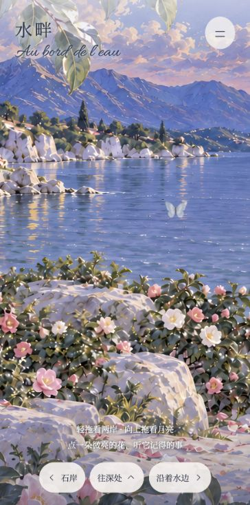
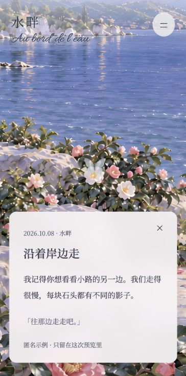

# 交接：水畔 2.5D 网页候选

日期：2026-10-13。供佳佳试画风、手感，Claude 通过 GitHub 核对。

## 分支与边界

- 分支：`codex/memory-garden-water-preview`
- 干净基线：`e9980dc535c62b0584702392cfd02cf0c9e9e324`（`claude/build92`）。没有把未提交的原生 Build 94 候选带进来。
- 本轮只有 `Design/WaterGardenPreview/` 与这份交接文档。没有修改原生 App、版本号、MemoryGardenStore、Thinking 或后端。
- 用户授权只推独立分支。没有合并、触发打包、上架、部署网站、SSH 或重启服务器。
- 还没有用户最终验收；请先看网页，确认后再扩展地点或移植 App。

## 先看这些

本次高清修订仍在同一分支。三层重新修复后 AI 超分到 6144×4096，支持 DPR 3，限制最大推近，先轻量预览后高清替换。详见 [本次核验与限制](../Design/WaterGardenPreview/review/hd/VERIFICATION.md) 和 [素材处理/完整提示词](../Design/WaterGardenPreview/art/HD-PROMPTS.md)。没有打包或上线。

[3× 原尺寸全景](../Design/WaterGardenPreview/review/hd/overview-3x.png) · [3× 最大推近](../Design/WaterGardenPreview/review/hd/detail-3x.png)。均为 1170×2532 的网页 Canvas 原帧，不是真机截图；完整 DOM 界面见下面截图。

[网页说明、截图及启动方式](../Design/WaterGardenPreview/README.md)

[修清晰度前的 20 秒实时画布录像](../Design/WaterGardenPreview/review/walkthrough-20s.webm) · [录制元数据](../Design/WaterGardenPreview/review/capture.json)

GitHub 普通文件页面不会运行网页。本轮未启用 Pages；云端可读取源文件、图片、WebM，具备浏览器运行环境时可克隆分支并启动本地服务。

## 本轮完成的机制

1. 三层连续手绘水边：远景月亮/天空/山，中景河水/岸石/整片山茶花海，近景透明叶枝。中景里的花就是花本身，不渲染单花或灌木 PNG 来装饰环境。
2. 左右拖看两岸、上拖抬头、双指/滚轮缩放；远景 0.68、中景 1、近景 1.26 的镜头位移倍率。有限画幅内看景，不是真 3D 自由绕行。
3. 24 处画中花心锚点，对应 24 条匿名样例；光点与命中测试共享中景坐标变换。
4. 点花后镜头靠近、沿用先前的贝母半透明蝴蝶飞到花心、卡片出现；合上返回原视角。卡片不加压暗背景的遮罩。
5. 局部水面微光波纹、近景叶枝轻摆、少量飘落花瓣与萤火虫；减弱动态可关闭装饰运动。
6. 前/左/右入口会推进镜头，并明确显示下一处未开放，不冒充已完成三个地点。
7. 一键录制实时画布漫游。20.003 秒，730×1466，WebM VP9，约 9 MB；已在网页播放器检查开头、12 秒记忆段和19秒位置可解码。录制时间/帧计数不等同于性能基准。

## 明确没有完成的部分

- 仅水畔月光一套，不含清晨和其他四个地点。
- 不是三维世界，不能绕到石头背面。画中每朵花不会单独弯枝、开合或改变形态；本轮机制是整幅花海里的花心热点。
- 没有真数据，示例文字只用于观看效果，24条中有复用文案。没有网络 cookie、真实消息、医疗信息或账号信息。
- 600 多条仅做了分配/溢出逻辑单测；没有600朵同时渲染或真机流畅度结论。
- 没有接入喜欢、记错了、枯掉的花、恢复、旧记忆开关。这些业务后续继续复用既有 `MemoryGardenStore`，不要为网页重写服务。
- 深处入口和容量溢出接口已留，深处场景未实现。ID映射持久化尚未接后端。
- 没有 iPhone 真机录像。本轮视频是网页 Canvas 实时录制，路线由按钮脚本驱动；DOM 卡片文字在录制画布同步重绘。实际 UI 以网页及截图为准。

## 如何接真记忆而不把花弄错

入口为 `Design/WaterGardenPreview/dist/world.mjs` 的 `slots` 与 `allocateMemories(records, previousManifest)`。

- 一个 slot 只对应一个记忆 ID。`previousManifest` 应持久保存，下一轮原样传入；不能每次随排序重新洗牌。
- 高清花心坐标见 `imageSlots`，基于 `midground-hd.webp`（6144×4096），再按比例转换成 `slots` 的1536×1024逻辑坐标。24个ID沿用不变。修改中景构图后必须重新校准坐标。
- 超过24条返回 `overflow` 和 `nextLocation: water-deeper`，由后续地点路由接住；不能复制同一热点塞多条记忆。
- 需要表达重要性、心情、开合时，应另定“画中热点”的视觉语义；当前不会从数值改变已画好的花，不能宣称沿用了此前单花状态的完整表现。

## 检验与限制

- Node 单测12/12通过；本次新增DPR上限、高清锚点换算、3×屏初始与推近采样上限、大屏不放大源像素、低清预览推近限制。其余包括热点与647条分流，不是真机性能基准。
- 本机窄视口365×733：进入、点真实花心、卡片、看月亮、录像与回放检查；浏览器未记录页面错误。
- 桌面1280×800尺寸覆盖尝试有预览工具截图缩放偏差：实际CSS1066×666，截图内容被额外缩放、边缘多出空白。已排除这些无效截图，不宣称桌面视觉验收通过。坐标单测含横屏，但不替代视觉验收。
- 静态检测降级为正则模式，不能检查计算对比度；两项字体文档警告由本目录设计说明记录，不能视为完整可访问性认证。
- 独立检查的两项P2（隐藏列表焦点恢复、手动减弱动态漏停CSS）均已修复并回验Resolved；结论仅为可展示的手机网页候选。详见 [核验记录](../Design/WaterGardenPreview/review/VERIFICATION.md)。
- 本地 `/capture` 只绑定127.0.0.1，验证Origin/Host、视频类型、32MB上限与时长；没有发到外部服务。

## 后续建议顺序

佳佳先看这一处画风和拖动感觉 → Claude 核对锚点与接入约定 → 完成深处地点与真记忆适配 → 再选择原生复用的素材/镜头方案 → 真机性能和动态效果验收。这个顺序不是继续开发或发布的自动授权。

素材提示词见 [ASSET-PROMPTS.md](../Design/WaterGardenPreview/ASSET-PROMPTS.md)，蝴蝶原始来源见 [BUTTERFLY-PROVENANCE.md](../Design/WaterGardenPreview/BUTTERFLY-PROVENANCE.md)。字体各自 OFL 随素材提交。
