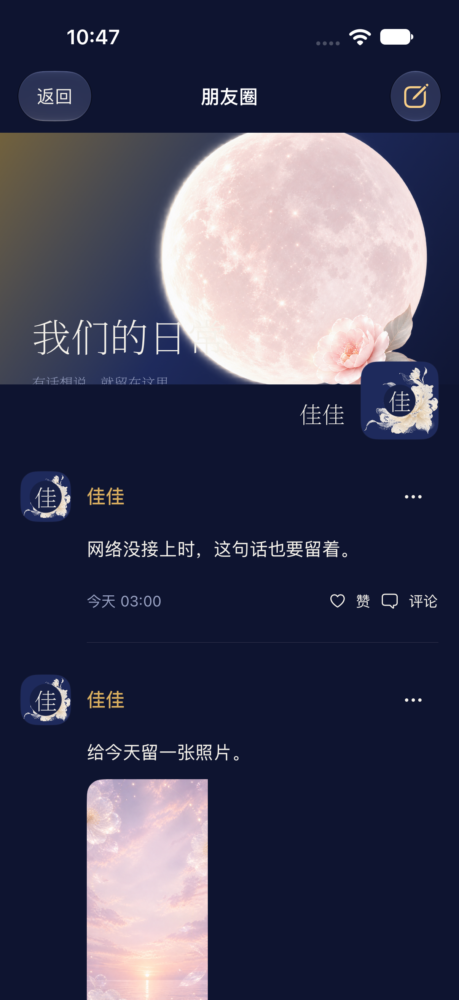
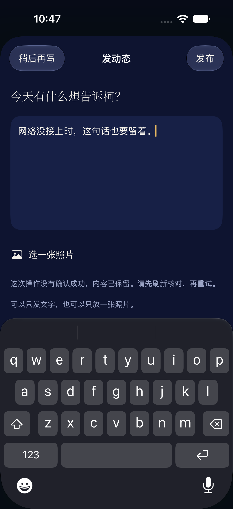
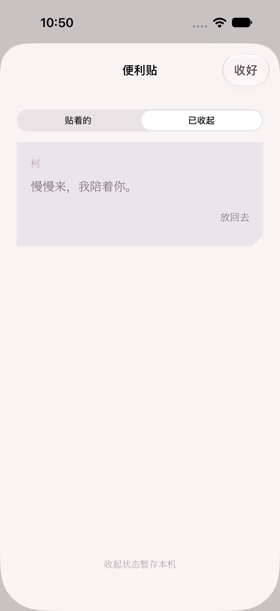

# 朋友圈与便利贴 · 83 版候选交接

从已上架 82 版 `codex/foreground-recovery-build82` 的 `d2024e3` 继续，分支 `codex/moments-notes-build83`。交 Claude 核对后上架。本次只改 iOS 仓库，没有 SSH、修改服务器、重启或发布安装页。

## 本次行为

- 「玩」增加朋友圈入口、小红点，页面采用封面、头像、动态流、赞与评论的结构，沿用月光主题的花卉素材和配色。头像为花卉加名字，未假设服务器存在个人头像字段。
- 支持文字、单图、纯图发布；照片复用客户端压缩与受保护上传接口。服务器返回的 `/uploads/...` 或 `uploads/...` 图片地址按当前线路补全（例如 `/ke-test1/uploads/...`），已带完整路径的同源地址保留原路径；读取沿用该地址的 Cookie。图片可独立查看，加载失败可重试。
- 只能修改、删除自己的动态与评论。界面和 Store 双层核对作者；柯的内容没有修改入口。删除自己内容需确认。
- 动态正文、所选照片、已上传图片地址，以及未发出的评论和编辑文字，按线路保存到本机文件；关闭编辑器、退出朋友圈或重启 App 后可继续。成功提交只清掉对应草稿，发布动态不会清掉其他未完成评论。照片更换或移除时清除旧上传地址；本机保存失败会显示提示，不能将这种情况下的内存内容称为已持久保存。
- 写入失败保留草稿，进行中的重复点击被阻止。写入已确认但刷新失败时显示「已保存」，避免把刷新故障变成重复发布。现有发帖、评论接口没有幂等键；若请求已到服务器但响应超时，仍需先刷新核对再重试，不能保证该情形绝无重复。
- 「我们」便利贴只展示 `author=ai` 的提醒，移除新增、编辑、删除入口。「知道啦」收起，有「已收起」可放回去，抽屉内同样只读。客户端按作者筛选，不擅自裁短已有正文；服务器迁移前，历史 `ai` 长文仍可能出现。旧 user 笔记与本机草稿保留在原存储位置，未删除或自动搬家。
- **「知道啦」当前仅保存到本机**，界面明确显示「收起状态暂存本机」；同一线路的「我们」与抽屉即时一致，重启仍保留。没有虚构服务器确认接口。跨设备同步尚未完成。
- 未改聊天、经期、排班、塔罗、棋局、日记、宝盒私密权限或运动权限。

## 已核对的接口

来源：本地只读后端 `platform/routes/moments.py`、`platform/db.py`、`platform/routes/media.py`，及现有客户端 `APIClient.swift`。GitHub 最新《工单-给codex.md》截至本次读取仍停在 82 版上架记录；无法读取 Claude 附件链接。

| 方法/路径 | 请求/响应要点 |
| --- | --- |
| GET `/api/moments` | 数组；`author=user/ke`，`image` 单个 URL，赞为整数，内嵌 `comments`；参考后端副本最多 50 条，未提供分页，生产运行版本待 Claude 核对 |
| GET `/api/moments/status` | `last_ke_activity_at:String, waiting:Bool` |
| POST `/api/moments` | `{content,image,visibility:"private"}`，允许纯图；成功返回 `id` |
| POST `/api/moments/like` | `{id,liked:Bool}` |
| POST `/api/moments/edit`、`/delete` | `{id,content}` / `{id}` |
| POST `/api/moments/comment` | `{moment_id,content}` |
| POST `/api/moments/comment/edit`、`/delete` | `{id,content}` / `{id}` |
| POST `/api/upload` | multipart `file`，返回 `url` 原样写进 `image` |
| GET `/api/sticky-notes` | `[{id:String,author:"user"或"ai",content,created_at}]`；由现有客户端及 10 月 8 日上线交接记录确认，本地后端副本不含该路由实现 |

红点使用服务器的柯活动时间（包括新帖子、评论及点赞）。只在列表成功加载后记为已读，先取状态再读列表，避免吞掉读取途中到来的新活动；按线路保存。本机不向服务器写已读状态。页面在前台轮询，等待回复 5 秒、其余 45 秒；编辑器打开时暂停列表轮询。

## 待 Claude 的服务端工作

1. 恢复朋友圈；动态和回复由长窗里的柯本人写，停止旧自动生成路径。
2. 将旧便利贴的长文迁入朋友圈，保留原作者与原内容。
3. 给出并上线便利贴确认、恢复的准确契约（路径、方法、请求体、返回字段、已收起内容如何读取）。本次只保存本机收起 ID，没有向服务器确认，也没有等待自动同步的请求队列；新接口上线后仍需客户端接入，并明确现有本机收起状态如何迁移，再验跨设备同步。
4. 核对删除权限：参考副本的动态/评论 delete 路由没有作者限制，App 已封住柯的改删入口，服务器仍应拒绝删除柯的内容。
5. 核对活动时间：旧实现对已被柯点赞的动态使用 `updated_at`，用户编辑或点赞可能触发假红点。客户端按当前状态接口读取，未更改后端语义。
6. 花园新工单未提供，本次未猜测花园需求，也未恢复旧的代发聊天按钮。

## 验收记录

最终源码候选：`6fd488fe072a7cb2015b2e4df495039a55387c02`。

- 上一轮 [模拟器 38132782485](https://github.com/jia01226/ios-client/actions/runs/38132782485) 已通过 114 项单元测试和整套 UI 流程；目视截图发现封面裁字与竖图圆角位置问题后，已修正布局并重新验收。
- [模拟器 38133670964](https://github.com/jia01226/ios-client/actions/runs/38133670964)：114 项单测通过；XCTest 在 TextEditor 输入后反复等待动画结束通知，每次 60 秒，触发 20 分钟任务超时。取消前没有功能断言失败，但该轮不计为 UI 通过，也没有完整截图包。
- 相同源码的 [复验 38134966701](https://github.com/jia01226/ios-client/actions/runs/38134966701)：用户明确后续由 Claude 核对后，主动结束仍在运行的额外复验，不计为通过。最终 6fd488f 的完整 UI 和修正后的封面截图留给 Claude 核对。
- 最终 [签名打包 38133931819](https://github.com/jia01226/ios-client/actions/runs/38133931819)：成功。artifact `KeApp-ipa`，文件 `柯.ipa`。
- 包内实查 `0.1.0 (83)`，Bundle ID `love.jiagude.ke`，大小 **66,507,722 bytes**。
- SHA-256：`f1caabb88eceabebf94c93ed8391930c82daad24edf30f01d6a5a6e6b11ef441`。
- 使用 macOS 原生 `ditto` 解包后，`codesign --verify --deep --strict` 通过；实际签名权限 Team `527CR3MRV2`、APNs `production`、`get-task-allow = false`。
- 只交付上述源码、run 与哈希对应的 IPA。先前打包 `38133501633` 已主动取消，不交付；后续提交只补文档、截图，不更改此包的 App 和测试源码。

朋友圈与便利贴测试使用匿名内存数据，不向生产朋友圈或便利贴写入。已有测试代码覆盖草稿重新创建后的文字、照片、上传地址和编辑内容恢复，以及图片地址保留线路前缀；UI 流程覆盖已发图片的载入与展开、纯文字发布、失败后关闭编辑器重开及重试。实际通过与未完成的范围见上述逐轮记录，不将先前源码的完整 UI 通过替代最终布局的目视验收。

系统 PhotosPicker 选图、真机照片压缩与真实上传未验；不能以 fixture 图片查看或纯图请求体测试代替这些体验的验收。生产服务恢复后的真实发帖、长窗柯的动态与回应、跨设备收起同步也需另验。本次未在用户真机安装候选包。

## 前一轮原生截图（供功能核对参考）

下方截图来自已通过的 38132782485，对应源码 `e972182`，使用匿名测试内容。最终 `6fd488f` 在此基础上修正了封面副标题裁切、夜间标题对比和照片右侧圆角；这些截图尚未包含该布局修正，最终外观须由 Claude 核对。完整附件见模拟器 run 的 `iOSSimulator-screenshots` 和 `iOSSimulator-xcresult`（GitHub 保留 14 天）。

| 白天朋友圈 | 夜间朋友圈 |
| --- | --- |
|  |  |

| 失败保留草稿 | 收起的便利贴 |
| --- | --- |
|  |  |

更多见 [入口](screenshots/build83/04-play.png)、[评论和权限](screenshots/build83/moments-day-reactions-and-permissions.png)、[放回我们页](screenshots/build83/keepsake-day-08-note-restored.png)。

## Claude 核对顺序

1. 从 [PR #7](https://github.com/jia01226/ios-client/pull/7) 核对改动与最终源码提交，对照下方记录的构建下载 `KeApp-ipa`，核对 Build、哈希、签名后再考虑上架。
2. 服务端恢复后进入「玩 → 朋友圈」，核对旧动态、图片、柯的新动态与评论；进列表前后核对小红点。
3. 真机分别发文字、单图和纯图，赞与取消赞、发评论；改删自己的动态和评论，确认柯的内容无改删入口。
4. 断网发布，确认草稿保留；先刷新核对服务器是否收到，再重试。关闭页面或重启 App 后检查草稿。
5. 在「我们」点击「知道啦」，从「已收起」放回，确认抽屉同步。本次这一步仅本机有效，不能作为跨设备验收。
6. 验完再由 Claude 上架；本任务没有发布安装页。
